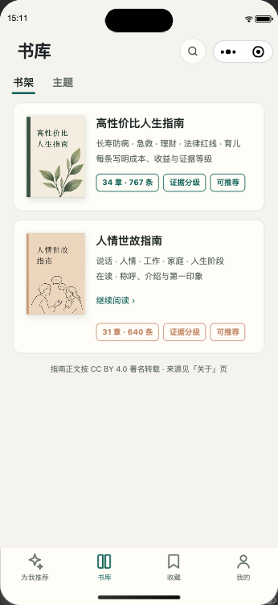
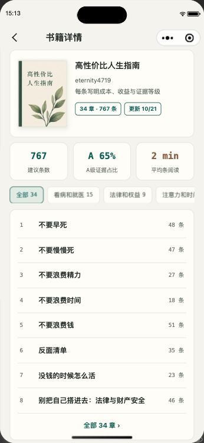
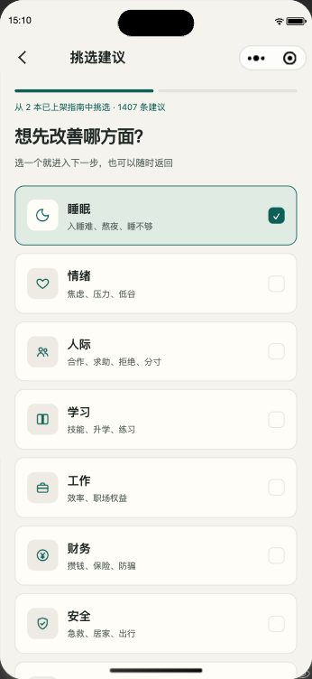
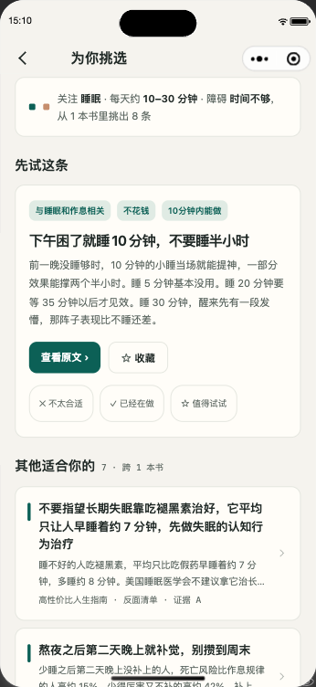
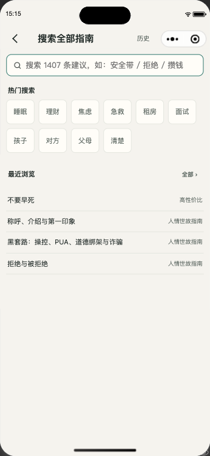
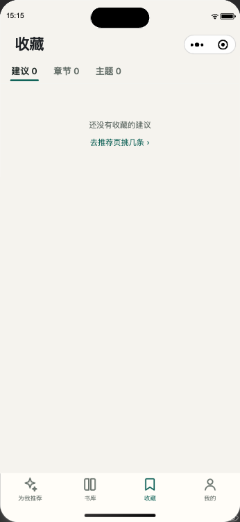

# 人生指南库 · 高性价比人生指南微信小程序


| 收录书目 | 规模 | 特点 |
| --- | --- | --- |
| 高性价比人生指南| 34 章 · 767 条 | 每条标注成本、收益与证据等级 |
| 人情世故指南| 31 章 · 640 条 | 讲清规则，也讲清人心 |

条目数随上游每日自动同步，以书库页实时数据为准。推荐由服务端完成，小程序端按「接口 → 本地缓存 → 随包基线」三层取数，弱网与离线也可用。

## 预览

微信扫一扫，直接使用线上小程序：

<p align="left">  
    
</p>

界面截图（更多页面见 [docs/images/v2-shots/](docs/images/v2-shots/)）：

<p align="center">  
    
    
    
    
</p>  
<p align="center">  
    
    
    
    
</p>  
<p align="center">
  <sub>推荐首页 · 书库 · 书籍详情 · 章节阅读 ｜ 挑选建议 · 推荐结果 · 搜索 · 收藏</sub>
</p>

## 项目结构

```
miniprogram/
├── app.js / app.json / app.wxss / theme.json / sitemap.json
├── pages/                # 主包
│   ├── reco/             # 为我推荐（tab）：hero + 最近更新 + 书架 + 每日一读
│   ├── library/          # 书库（tab）：书架 / 主题两个视角
│   ├── favorite/         # 收藏（tab）：建议 / 章节 / 主题
│   ├── mine/             # 我的（tab）：统计、账户与同步、反馈
│   ├── book-detail/      # 书籍详情：统计卡、主题筛选、章节列表
│   ├── topic-aggregate/  # 主题聚合：同一主题跨书章节，可收藏主题
│   └── index/            # 启动页（仅首次展示，之后直达推荐）
├── pkg-read/             # 分包：阅读
│   ├── chapter-read/     # 章节阅读：编号条目、上标引用、术语弹窗、排版调节
│   ├── search/           # 跨书全文搜索：热词 + 历史
│   ├── daily/            # 每日一读（书中金句）
│   ├── download/         # 离线下载（精彩解析版 PDF / EPUB / HTML）
│   ├── help/ about/ webview/
│   └── data/             # 随包正文基线（离线兜底，脚本生成，勿手改）
├── pkg-insight/          # 分包：挑选
│   ├── wizard/           # 两步挑选：方向多选（≤3）→ 时间预算 + 障碍
│   ├── result/           # 推荐结果：理由 chips、不满意即时换一条
│   ├── vip/              # 会员：离线免激励视频、结果免分享解锁、云同步
│   └── account/          # 账户与同步
├── pagesA/ pagesB/       # v1 遗留分包（仅保证旧分享链接可达，冻结不再迭代）
├── components/           # custom-nav / article-card / article-list / loading / empty-state / tip-panel / menu-guide
├── data/
│   ├── v2/               # 两书基线：books / chapters / topics / glossary / quotes（脚本生成，勿手改）
│   └── match-index.js    # 条目级精简索引（推荐本地兜底用，脚本生成，勿手改）
├── utils/                # api-v2 / library / match / store / migrate / pay / cloud-sync 等
├── styles/               # variables(-v2).wxss 设计令牌（--lb-*，含深色模式）
└── assets/               # 图标与插画（tools/gen-icons.mjs、render-assets.mjs 生成）

tools/                    # 截图 / 体积检查 / 同步 / 回归测试等 Node 脚本
docs/images/              # 小程序码 + 界面截图（packOptions 已忽略，不入包）
```

## 页面说明

| 页面 | 路径 | 说明 |
| --- | --- | --- |
| 为我推荐 | `pages/reco/reco` | 「今天想改善什么？」挑选入口、最近更新、书架、每日一读 |
| 书库 | `pages/library/library` | 书架（两本书 + 在读进度）/ 主题宫格 |
| 书籍详情 | `pages/book-detail/book-detail` | 建议数 / 证据占比 / 平均阅读、主题筛选、章节列表 |
| 主题聚合 | `pages/topic-aggregate/topic-aggregate` | 主题头卡（★ 收藏）、按书筛选、章节列表分批加载 |
| 章节阅读 | `pkg-read/chapter-read/chapter-read` | 编号条目、上标引用、术语弹窗、排版调节（字号/行距/底色）、收藏点赞 |
| 挑选建议 | `pkg-insight/wizard/wizard` | 两步向导：方向多选 → 时间预算 + 障碍，选中自动下一步 |
| 推荐结果 | `pkg-insight/result/result` | 首选大卡 + 理由 chips（无匹配百分比），✕ 反馈即时换一条 |
| 搜索 | `pkg-read/search/search` | 跨书全文搜索，热词 + 搜索历史 + 最近浏览 |
| 收藏 | `pages/favorite/favorite` | 建议 / 章节 / 主题 三类收藏 |
| 每日一读 | `pkg-read/daily/daily` | 日期 + 金句卡，换一句 / 分享 |
| 离线下载 | `pkg-read/download/download` | 精彩解析版 PDF / EPUB / HTML（会员免激励视频） |
| 我的 | `pages/mine/mine` | 收藏 / 浏览 / 在读统计，账户与同步、反馈入口 |
| 会员 | `pkg-insight/vip/vip` | 永久会员：离线下载免激励视频、深度分析免分享解锁、云同步 |
| 账户与同步 | `pkg-insight/account/account` | 微信账户登录、云同步管理（收藏 / 浏览记录 / 阅读位置） |

> `pages/home`、`pages/classify`、`pagesA`、`pagesB` 为 v1 遗留页面，已移出 tabBar，仅保证旧分享链接可达。

## 本地运行

1. 打开微信开发者工具。
2. 选择「导入项目」，目录选择 `miniprogram/`。
3. 在 `project.config.json` 中把 `appid` 改成你自己的小程序 AppID。
4. 点击「编译」即可预览。接口不可用时会自动回落随包基线，离线也能读正文。


## 开发工具（tools/）

| 脚本 | 用途 |
| --- | --- |
| `capture-v2.mjs` | 自动化截图：先 `cli auto --project . --auto-port 9420 --trust-project`，再 `node tools/capture-v2.mjs`，产出 `docs/images/v2-shots/` |
| `check-size.mjs` | 按分包分别检查 2 MB 上限，并给出主包体积 Top 榜 |
| `test-v2.cjs` | v2 回归断言（数据层 / 推荐兜底 / 收藏 uid 等） |
| `sync-articles.mjs` | v1 数据同步（legacy 页面用） |
| `build-match-index.mjs` | 生成推荐兜底索引 `data/match-index.js` |
| `render-assets.mjs` / `gen-icons.mjs` | 重新生成书封插画 / 图标 |

## 关键配置

- `app.json`：四个 tab（为我推荐 / 书库 / 收藏 / 我的）+ 三个分包（`pkg-read`、`pkg-insight`、legacy），进入推荐页时预下载 `read`、`insight` 分包。
- 深色模式：`app.json` 开启 `darkmode`，颜色统一走 `styles/variables-v2.wxss` 的 `var(--lb-*)` 令牌。
- 自定义导航栏在 `components/custom-nav` 实现，支持返回、标题（居中 / 左对齐大标题）、右侧插槽。
- 收藏、阅读进度等本地状态存 `htlb:v2:*` 命名空间；v1 → v2 由 `utils/migrate.js` 一次性迁移（先备份、幂等）。

## 注意事项

1. `project.config.json` 已配置正式 AppID，本地开发请替换成自己的 AppID 或测试号。
2. **主包余量常年只有几十 KB**：新增资源前先跑 `node tools/check-size.mjs`；大文件（如正文基线）一律放分包。
3. 真机调试前，把 `api.aipalnet.cn` 加入小程序后台「request 合法域名」，否则线上取数被静默拦截（仍会回落基线）。
4. `web-view` 只能打开「业务域名」内 HTTPS 链接，GitHub 等外链已做剪贴板复制降级。
5. iOS 端未开放虚拟支付购买入口（已购用户可在「账户与同步」恢复权益）。
6. 收藏与章节定位使用 v2 三段式 uid（`bookId:chapterId:stepIdx`），与旧裸 id 不兼容，页面间传参请走 v2 格式。

## 技术栈

- 微信原生小程序，无外部 UI 框架依赖，深色模式（`theme.json` + `--lb-*` 设计令牌）
- 数据三层：API → Storage 缓存 → 随包基线

## 版权与许可

本小程序收录的两本书均以 [CC BY 4.0](https://creativecommons.org/licenses/by/4.0/) 授权：

- [《高性价比人生指南》](https://github.com/eternity4719/HowToLiveBetter)（作者 [eternity4719](https://github.com/eternity4719)）
- [《人情世故指南》](https://github.com/changxueyi/renqing-shigu)（作者 [changxueyi](https://github.com/changxueyi)）

本仓库整体（内容与代码）同样以 [CC BY 4.0](LICENSE) 授权。转载或二次分发时，请按 CC BY 4.0 的要求保留对上述原书及本项目的署名。
